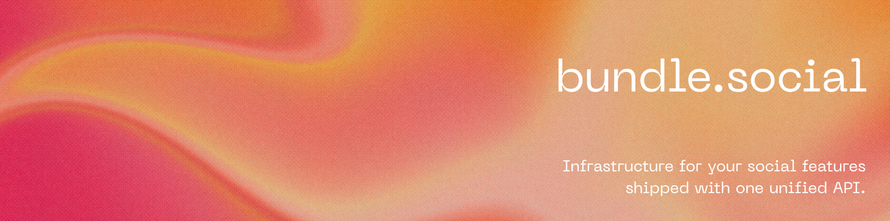

<div align="center">

<a href="https://bundle.social/?ref=github-org-readme">
  
</a>

### Ship social features, not fifteen OAuth integrations.

One REST API for publishing, comments, media and analytics across **15 social platforms**.<br>
Unlimited connected accounts, no per-account charges. The API is closed. The tooling around it is open, and it is all here.

[Docs](https://info.bundle.social/welcome?ref=github-org-readme) •
[OpenAPI spec](https://api.bundle.social/swagger-json) •
[MCP server](https://info.bundle.social/api-reference/mcp?ref=github-org-readme) •
[Get an API key](https://bundle.social/auth/sign-up?ref=github-org-readme) •
[Status](https://bundlesocial.betteruptime.com)

</div>

```bash
npm install bundlesocial
```

```typescript
import { Bundlesocial } from 'bundlesocial';

const bundle = new Bundlesocial(process.env.BUNDLE_SOCIAL_API_KEY!);

await bundle.post.postCreate({
  requestBody: {
    teamId: '<TEAM_ID>',
    title: 'Hello world from bundle.social',
    status: 'SCHEDULED',
    postDate: new Date(Date.now() + 60 * 60 * 1000).toISOString(),
    socialAccountTypes: ['TWITTER', 'LINKEDIN', 'INSTAGRAM'],
    data: {
      TWITTER: { text: 'Hello world from bundle.social!' },
      LINKEDIN: { text: 'Hello world from bundle.social!' },
      INSTAGRAM: {
        type: 'POST',
        text: 'Hello world from bundle.social!',
        uploadIds: ['<UPLOAD_ID>'],
      },
    },
  },
});
```

[](https://www.npmjs.com/package/bundlesocial)
[](https://www.npmjs.com/package/bundlesocial-cli)
[](https://www.npmjs.com/package/bundlesocial-mcp)
[](https://api.bundle.social/swagger)
[](https://info.bundle.social/welcome?ref=github-org-readme)

No SDK, no problem. Base URL `https://api.bundle.social`, everything under `/api/v1`, an `x-api-key` header, that is the whole contract:

```bash
# 0. Is anything on fire? This one needs no key.
curl https://api.bundle.social/api/v1

# 1. Which teams does this key own? teamId is the workspace every other call hangs off.
#    Every id in the API - teams, uploads, posts, accounts - is a UUID v4.
curl https://api.bundle.social/api/v1/team \
  -H "x-api-key: $BUNDLE_SOCIAL_API_KEY"

# 2. Schedule a post to the accounts connected to one of them.
#    postDate is any ISO 8601 timestamp; status is DRAFT or SCHEDULED.
curl -X POST https://api.bundle.social/api/v1/post \
  -H "x-api-key: $BUNDLE_SOCIAL_API_KEY" \
  -H "Content-Type: application/json" \
  -d '{
    "teamId": "<TEAM_ID>",
    "title": "Hello from bundle.social",
    "status": "SCHEDULED",
    "postDate": "2027-01-15T15:00:00.000Z",
    "socialAccountTypes": ["TWITTER"],
    "data": { "TWITTER": { "text": "Hello from bundle.social" } }
  }'
```

## Platforms

Same request, same auth, same error contract for every one of them. You change one entry in `socialAccountTypes`, not one integration.

| Platform | `socialAccountTypes` value |
|---|---|
| [Instagram](https://info.bundle.social/api-reference/platforms/instagram?ref=github-org-readme) | `INSTAGRAM` |
| [TikTok](https://info.bundle.social/api-reference/platforms/tiktok?ref=github-org-readme) | `TIKTOK` |
| [YouTube](https://info.bundle.social/api-reference/platforms/youtube?ref=github-org-readme) | `YOUTUBE` |
| [Facebook](https://info.bundle.social/api-reference/platforms/facebook?ref=github-org-readme) | `FACEBOOK` |
| [LinkedIn](https://info.bundle.social/api-reference/platforms/linkedin?ref=github-org-readme) | `LINKEDIN` |
| [Twitter / X](https://info.bundle.social/api-reference/platforms/twitter?ref=github-org-readme) | `TWITTER` |
| [Threads](https://info.bundle.social/api-reference/platforms/threads?ref=github-org-readme) | `THREADS` |
| [Snapchat](https://info.bundle.social/api-reference/platforms/snapchat?ref=github-org-readme) | `SNAPCHAT` |
| [Pinterest](https://info.bundle.social/api-reference/platforms/pinterest?ref=github-org-readme) | `PINTEREST` |
| [Reddit](https://info.bundle.social/api-reference/platforms/reddit?ref=github-org-readme) | `REDDIT` |
| [Bluesky](https://info.bundle.social/api-reference/platforms/bluesky?ref=github-org-readme) | `BLUESKY` |
| [Mastodon](https://info.bundle.social/api-reference/platforms/mastodon?ref=github-org-readme) | `MASTODON` |
| [Discord](https://info.bundle.social/api-reference/platforms/discord?ref=github-org-readme) | `DISCORD` |
| [Slack](https://info.bundle.social/api-reference/platforms/slack?ref=github-org-readme) | `SLACK` |
| [Google Business](https://info.bundle.social/api-reference/platforms/google-business?ref=github-org-readme) | `GOOGLE_BUSINESS` |

> [!NOTE]
> The platform list and its enum values come from the `socialAccountTypes` enum in the [published OpenAPI spec](https://api.bundle.social/swagger-json), which is the contract that decides what you can actually post to. If a README anywhere lags a platform behind, the enum is the contract.

## What you can call

One key, one base URL, 114 paths in the published spec. A sample of the surface:

<!-- Recompute the path count with:
     curl -s https://api.bundle.social/swagger-json | python3 -c 'import json,sys; print(len(json.load(sys.stdin)["paths"]))'
     It only ever grows, so a stale number understates rather than overstates. -->

| Area | Endpoints | Does |
|---|---|---|
| **Publish** | `POST /api/v1/post` · `/post/{id}/retry` · `/post/reference-key/{key}` | Schedule or publish, per-platform overrides under `data.<PLATFORM>`, retries, your own idempotency key |
| **Media** | `/upload` · `/upload/from-url` · `/upload/multipart/*` | Images, video and documents up to 5&nbsp;GB, multipart or straight from a URL, transcoding handled |
| **Accounts** | `/social-account/connect` · `/create-portal-link` · `/set-channel` · `/refresh-channels` | Hosted OAuth or your own UI, page/channel/location selection, token refresh you never see |
| **Analytics** | `/analytics/social-account` · `/analytics/post` · `/analytics/post/bulk` · `/analytics/*/raw` | Normalized views, impressions, likes and demographics, plus the untouched platform payload |
| **Comments** | `/comment` · `/comment/import` · `/comment/import/comments/{id}/action` | Auto first comments, comment import, moderation actions |
| **Import** | `/post-history-import` · `/post-csv-import` | Backfill posts and analytics from before you connected; bulk-create from CSV |
| **Platform extras** | `/misc/youtube/*` · `/misc/linkedin/*` · `/misc/reddit/*` · `/misc/google-business/*` | Edit and delete after publish, playlists, thumbnails, LinkedIn mentions, subreddit flairs, GBP hours and reviews |
| **Plumbing** | `GET /api/v1` · `/organization/usage/*` · `/team` | Live per-platform health, usage metering, teams as tenants |

> [!TIP]
> Building multi-tenant? A **team per customer** is the pattern - accounts, posts and daily limits are scoped to a team, while API keys and webhooks are org-wide. Start at the [API introduction](https://info.bundle.social/api-reference/introduction?ref=github-org-readme). Prefer to generate your own client? The [spec](https://api.bundle.social/swagger-json) is public and complete.

## SDK and tooling

<!-- Curation rule: one row per officially maintained package. Do not add a row until it is
     published and the install command in it actually works. -->

| Package | Install | Version |
|---|---|---|
| [Node.js SDK](https://github.com/bundleglobal/bundlesocial-node) | `npm install bundlesocial` | [](https://www.npmjs.com/package/bundlesocial) |
| [CLI](https://info.bundle.social/api-reference/cli?ref=github-org-readme) | `npm install -g bundlesocial-cli` | [](https://www.npmjs.com/package/bundlesocial-cli) |
| [MCP server](https://info.bundle.social/api-reference/mcp?ref=github-org-readme) | `npx bundlesocial-mcp` | [](https://www.npmjs.com/package/bundlesocial-mcp) |

The SDK is generated from the OpenAPI spec. Need Python, Go or anything else? Point your generator at [the spec](https://api.bundle.social/swagger-json), or [ask us](https://github.com/bundleglobal/bundlesocial-examples/issues).

<details>
<summary><strong>Python quickstart, no SDK required</strong></summary>

<br>

```python
import os, requests
from datetime import datetime, timedelta, timezone

BASE = "https://api.bundle.social/api/v1"
HEADERS = {"x-api-key": os.environ["BUNDLE_SOCIAL_API_KEY"]}

post_date = (datetime.now(timezone.utc) + timedelta(hours=1)).isoformat()

r = requests.post(
    f"{BASE}/post",
    headers=HEADERS,
    json={
        "teamId": os.environ["BUNDLE_SOCIAL_TEAM_ID"],
        "title": "Hello world from bundle.social",
        "status": "SCHEDULED",
        "postDate": post_date,
        "socialAccountTypes": ["TWITTER", "LINKEDIN"],
        "data": {
            "TWITTER": {"text": "Hello world from bundle.social!"},
            "LINKEDIN": {"text": "Hello world from bundle.social!"},
        },
    },
)
r.raise_for_status()
print(r.json())
```

A runnable version lives in [`bundlesocial-examples/python`](https://github.com/bundleglobal/bundlesocial-examples/tree/main/python).

</details>

## Agents, editors and automation

| What | How |
|---|---|
| [MCP server](https://info.bundle.social/api-reference/mcp?ref=github-org-readme) | `npx bundlesocial-mcp` - a local stdio server exposing the whole API as MCP tools, for Claude Code, Claude Desktop, Cursor and any other MCP client |
| [CLI](https://info.bundle.social/api-reference/cli?ref=github-org-readme) | `npx bundlesocial-cli` - JSON on stdout, human status on stderr, so it pipes into `jq`, into CI, into cron and into shell-out agents. Requires Node 20+ |
| [MCP agent example](https://github.com/bundleglobal/bundlesocial-examples/tree/main/mcp-agent) | A working agent wired to the MCP server, ready to clone |
| [Make.com](https://github.com/bundleglobal/bundlesocial-examples/tree/main/make.com/tiktok) | No-code TikTok workflow built on the REST API |
| [Postman workspace](https://www.postman.com/bundlesocial/workspace/bundle-social-api/overview) | The whole API, importable, no local setup |

## Examples

Runnable code, not pseudocode. The fastest way to see what the API can carry.

| Project | Stars | What it is |
|---|---|---|
| **[bundlesocial-examples](https://github.com/bundleglobal/bundlesocial-examples)** | [](https://github.com/bundleglobal/bundlesocial-examples) | Every example below, one repo. Each directory is independent - clone it and run the one that matches your runtime |
| [`nextjs/`](https://github.com/bundleglobal/bundlesocial-examples/tree/main/nextjs) | | Full-stack SaaS integration: connect flow, composer, scheduling |
| [`express/`](https://github.com/bundleglobal/bundlesocial-examples/tree/main/express) | | Node backend: server-side publishing and webhook handling |
| [`python/`](https://github.com/bundleglobal/bundlesocial-examples/tree/main/python) | | Scripts and backend jobs straight against the REST API |
| [`mcp-agent/`](https://github.com/bundleglobal/bundlesocial-examples/tree/main/mcp-agent) | | An AI agent posting through the MCP server |
| [`cli-github/`](https://github.com/bundleglobal/bundlesocial-examples/tree/main/cli-github) | | CI/CD automation driving the CLI from GitHub Actions |

<details>
<summary><strong>Also in this org</strong></summary>

<br>

<!-- Curation rule for future editors: the tables above are the supported set, not the org repo list
     (GitHub already renders that below this README). A repo is promoted out of this fold only when
     it is actively maintained, carries a LICENSE file, and is useful to someone integrating the API. -->

| Repo | What it is |
|---|---|
| [bundlesocial-node](https://github.com/bundleglobal/bundlesocial-node) | Source of the typed TypeScript SDK, generated from the OpenAPI spec |
| [bundlesocial-docs](https://github.com/bundleglobal/bundlesocial-docs) | The MDX behind [info.bundle.social](https://info.bundle.social). Typo in the docs? PR it here |

Anything not listed on this page is an experiment, a fork or an archive.

</details>

## Start

1. [Create an account](https://bundle.social/auth/sign-up?ref=github-org-readme) and generate a key under **API Keys** in the dashboard.
2. `export BUNDLE_SOCIAL_API_KEY=pk_live_...`
3. Create a team, connect an account, paste either snippet above.

Connected accounts are unlimited on every plan, so step 3 never turns into a per-seat conversation.

[Pricing](https://bundle.social/pricing?ref=github-org-readme) ·
[Changelog](https://info.bundle.social/changelog?ref=github-org-readme) ·
[Webhooks](https://info.bundle.social/api-reference/webhooks?ref=github-org-readme) ·
[Rate limits](https://info.bundle.social/api-reference/rate-limits?ref=github-org-readme) ·
[Platform limits](https://info.bundle.social/api-reference/limits?ref=github-org-readme) ·
[Status](https://bundlesocial.betteruptime.com)

Bugs and feature requests go in the issue tracker of the relevant repo above.

<div align="center">

[<kbd> <br> Get an API key ➜ <br> </kbd>](https://bundle.social/auth/sign-up?ref=github-org-readme)
&nbsp;&nbsp;
[<kbd> <br> Read the docs ➜ <br> </kbd>](https://info.bundle.social/welcome?ref=github-org-readme)

</div>

<!-- Platform count here follows the socialAccountTypes enum in the published OpenAPI spec,
     which is the contract that decides what can actually be posted to. Update both together. -->
